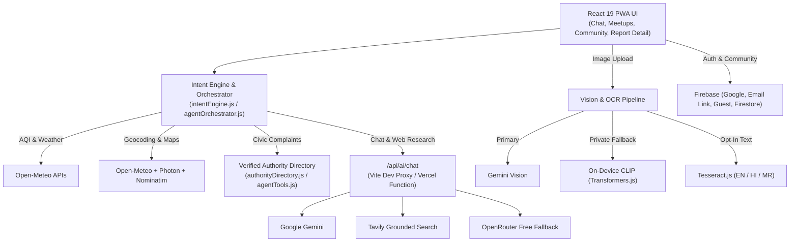

<div align="center">
  
  <h1>EcoPulse AI</h1>
  <p>
    <strong>Conversational intelligence for live environmental telemetry, civic grievance routing, and privacy-first community action.</strong>
  </p>

  <p>
    <a href="https://ecopulse-ai-ruby.vercel.app">
      
    </a>
    
    
    
  </p>

  <p>
    
    
    
    
    
    
  </p>

  <p>
    <a href="https://ecopulse-ai-ruby.vercel.app">Live App</a>
    &nbsp;·&nbsp;
    <a href="https://youtu.be/mrQLC5kSaBU">Project Demo Video</a>
    &nbsp;·&nbsp;
    <a href="#interface-preview">UI Preview</a>
    &nbsp;·&nbsp;
    <a href="#-key-capabilities">Capabilities</a>
    &nbsp;·&nbsp;
    <a href="#-architecture">Architecture</a>
    &nbsp;·&nbsp;
    <a href="#-quick-start">Quick Start</a>
    &nbsp;·&nbsp;
    <a href="#verification">Verification</a>
    &nbsp;·&nbsp;
    <a href="#-privacy--safety-model">Privacy & Safety</a>
    &nbsp;·&nbsp;
    <a href="FIREBASE_SETUP.md">Firebase Setup</a>
  </p>
</div>

---

## Overview

**EcoPulse AI** is a mobile-first Progressive Web App and civic-environmental assistant built with React, Vite, Firebase, and a multi-provider AI proxy. It combines natural-language reasoning with real-time environmental telemetry, verified municipal/forest authority routing, on-device vision & OCR fallbacks, and a privacy-minimized community channel.

Instead of leaving users with generic chatbot replies or unverified contact details, EcoPulse AI routes queries through an intent engine to live APIs, verified official `.gov.in` / municipal directories, and server-side grounded search—while keeping all API secrets off the client bundle.

---

## Interface Preview

<div align="center">
  
  <p>EcoPulse Chat home screen</p>
</div>

---

## ✨ Key Capabilities

| Area | What It Does | Powered By |
| :--- | :--- | :--- |
| **Conversational Assistant** | Natural-language chat in **English, Hindi, and Hinglish** with automatic language detection, daily-life civic guidance, and deterministic fallback responses. | Gemini AI, OpenRouter Free, `fallbackBrain.js` |
| **Personalized Smog Action Plan** | Combines a verified city and the user's commute, routine, cooking, and filtration details. Explains which steps reduce exposure and which reduce emissions. | `smogPlan.js`, city lookup, Open-Meteo AQI forecast |
| **Air Quality & Weather** | Shows current modeled U.S. AQI, pollutant estimates, and weather. The smog plan displays the AQI source time and does not use stale or undated readings as current. | Open-Meteo Air Quality & Forecast APIs |
| **Typo-Tolerant Global Maps** | Resolves misspelled or landmark-level locations (e.g., reserves, beaches, neighborhoods) into verified coordinates and Google Maps deep links. | Open-Meteo, Photon, Nominatim (OSM) |
| **Civic Grievance & Email Routing** | Classifies incidents (tree cutting, mangrove dumping, open burning, sewage, waste), surfaces verified helplines/portals, and drafts formal complaints with **Forest Dept CC** and **1-click Gmail Compose**. | `authorityDirectory.js`, `agentTools.js` |
| **Grounded Web Research** | Answers current-events and policy questions with cited, clickable official sources rather than ungrounded guesses. | Tavily Search API (`/api/ai/chat`) |
| **Vision & Opt-In OCR** | Analyzes uploaded incident photos for severity and category, with private on-device classification and opt-in multilingual OCR (**English, Hindi, Marathi**). | Gemini Vision, Transformers.js (CLIP), Tesseract.js |
| **Community & Eco-Meetups** | Public location-tagged community feed and local eco-events (cleanups, plantation drives) with RSVP support and guest read-only mode. | Firebase Auth, Cloud Firestore |

---

## 🏗 Architecture

All AI and web-search provider secrets remain server-side behind `/api/ai/chat` (handled by the Vite dev proxy locally and Vercel Serverless Functions in production).



### Provider Routing & Resilience

| Capability | Primary Provider | Fallback Chain |
| :--- | :--- | :--- |
| **Chat & Drafting** | Google Gemini | OpenRouter Free → Deterministic `fallbackBrain.js` |
| **Grounded Web Search** | Tavily Search | Gemini grounding → Honest unavailable notice |
| **Image Classification** | Gemini Vision | On-device CLIP (`onDeviceVision.js`) → User confirmation |
| **Document / Sign OCR** | Tesseract.js (opt-in) | Prompt user to clarify unclear text |
| **AQI, Weather & Geo** | Open-Meteo | Photon / Nominatim (OSM) → Clear unavailable state |

---

## 📁 Project Structure

<details>
<summary><strong>Click to expand repository layout</strong></summary>

```text
ecopulse-ai/
├── api/
│   └── ai/
│       ├── chat.js                  # Vercel serverless AI & Tavily proxy
│       └── health.js                # Provider health check endpoint
├── public/
│   └── bot-logo.svg                 # EcoPulse logo and browser tab icon
├── src/
│   ├── agent/
│   │   ├── agentOrchestrator.js     # Central intent execution, city extraction & context injection
│   │   ├── fallbackBrain.js         # Deterministic offline/error fallback responses
│   │   └── intentEngine.js          # Priority-ordered English/Hindi/Hinglish intent classifier
│   ├── components/
│   │   ├── BottomNav.jsx            # Mobile-first bottom navigation
│   │   ├── chat/
│   │   │   ├── ChatInput.jsx        # Auto-focused chat composer + image attachment
│   │   │   ├── Header.jsx           # App header, location badge & account menu
│   │   │   ├── InlineCards.jsx      # AQI, Report, Email (with CC & Gmail), Meetup & Map cards
│   │   │   ├── MessageBubble.jsx    # Markdown, citations & inline card renderer
│   │   │   └── QuickActions.jsx     # Context-aware city quick prompts
│   │   └── meetups/
│   │       └── EventCard.jsx        # Eco-event card with RSVP state
│   ├── contexts/
│   │   ├── AppContext.jsx           # Location & global app state
│   │   └── AuthContext.jsx          # Firebase Google, Email-link & Anonymous auth
│   ├── firebase/
│   │   ├── collections.js           # Firestore collection helpers
│   │   └── config.js                # Firebase initialization
│   ├── pages/
│   │   ├── LandingPage.jsx          # Entry & onboarding view
│   │   ├── ChatPage.jsx             # Main conversational assistant interface
│   │   ├── CommunityPage.jsx        # Public location-tagged community feed
│   │   ├── MeetupsPage.jsx          # Event discovery, creation & RSVP
│   │   └── ReportDetailPage.jsx     # Individual environmental report view
│   ├── services/
│   │   ├── agentTools.js            # Verified contacts, reports, drafts & meetups store
│   │   ├── aiClient.js              # Client wrapper for /api/ai/chat
│   │   ├── authorityDirectory.js    # Official municipal & forest authority lookup
│   │   ├── environmentalData.js     # Open-Meteo, Photon & Nominatim integrations
│   │   ├── geminiService.js         # Gemini model chain & system instructions
│   │   ├── imageOcr.js              # Opt-in Tesseract.js OCR (EN/HI/MR)
│   │   └── onDeviceVision.js        # Private on-device CLIP image classifier
│   ├── App.jsx
│   ├── index.css
│   └── main.jsx
├── FIREBASE_SETUP.md                # Step-by-step Firebase & Firestore rules guide
├── firestore.rules                  # Strict Firestore security rules
├── firestore.indexes.json           # Composite query indexes
├── vercel.json                      # Vercel SPA + /api routing
└── vite.config.js                   # Vite config + local /api/ai dev proxy
```

</details>

---

## 🚀 Quick Start

### Prerequisites
- **Node.js 20+** and **npm**
- A **Google Gemini API key** ([Google AI Studio](https://aistudio.google.com/apikey)) is optional for model-powered replies. The smog plan and automated tests do not require one.
- A **Firebase project** (optional for local UI testing; required for cloud auth & Firestore community)

### Installation

```bash
# 1. Clone the repository
git clone https://github.com/surajns0033-collab/ecopulse-ai.git
cd ecopulse-ai

# 2. Install dependencies
npm install

# 3. Create your local environment file
cp .env.example .env       # macOS / Linux
# copy .env.example .env   # Windows CMD / PowerShell

# 4. Start the local dev server (with built-in /api/ai proxy)
npm run dev
```

To verify the exact code shown on GitHub, check out that revision after cloning, or use **Code → Download ZIP** from that revision.

### Environment Variables

Configure these in `.env` (never commit `.env` to version control):

```env
# Server-side AI & Search (kept off the client bundle)
GEMINI_API_KEY=your_gemini_api_key
TAVILY_API_KEY=your_tavily_api_key          # Optional: grounded web search
OPENROUTER_API_KEY=your_openrouter_key      # Optional: free-tier fallback
OPENROUTER_MODEL=openrouter/free

# Firebase (client-side public config)
VITE_FIREBASE_API_KEY=
VITE_FIREBASE_AUTH_DOMAIN=
VITE_FIREBASE_PROJECT_ID=
VITE_FIREBASE_STORAGE_BUCKET=
VITE_FIREBASE_MESSAGING_SENDER_ID=
VITE_FIREBASE_APP_ID=
```

See [`.env.example`](.env.example) for all optional keys (including OpenWeatherMap, WAQI, and Google Maps).

---

## 🔐 Privacy & Safety Model

- **Minimal Public Footprint:** EcoPulse never copies user email addresses, phone numbers, Google display names, or precise GPS coordinates into public Firestore documents. Community posts store only the Firebase UID, chosen public alias, message text, timestamp, and an optional city/global label.
- **Guest Mode:** Anonymous users can browse the public community channel in read-only mode without creating an account, enforced by [`firestore.rules`](firestore.rules).
- **Human-in-the-Loop Complaints:** Drafted complaint emails are **never** sent automatically. Users review, edit, copy, or open them in Gmail with explicit confirmation.
- **Zero Contact Fabrication:** Authority emails and helplines are pulled strictly from verified official directories or grounded search; unknown cities are routed to official national portals such as [CPGRAMS](https://pgportal.gov.in) and the 24/7 Forest Helpline (`1926`).
- **Distinguished Guidance:** Responses separate immediate on-the-spot emergency actions from formal grievance filing, and frame health tips as general information rather than medical diagnosis.

---

## ☁️ Deployment

### Firebase Setup
Follow [`FIREBASE_SETUP.md`](FIREBASE_SETUP.md) to enable **Google**, **Email/Password (Passwordless Email Link)**, and **Anonymous** sign-in providers, then deploy security rules and indexes:

```bash
npx firebase-tools deploy --only firestore:rules,firestore:indexes
```

### Vercel Deployment
The repository ships ready for Vercel with [`vercel.json`](vercel.json) and serverless endpoints (`api/ai/chat.js`, `api/ai/health.js`):
1. Add server-side keys (`GEMINI_API_KEY`, `TAVILY_API_KEY`, `OPENROUTER_API_KEY`) in **Vercel Project Settings → Environment Variables**.
2. Add `VITE_FIREBASE_*` variables for the client build.
3. Add your deployed Vercel domain under **Firebase Authentication → Settings → Authorized domains**.

---

## 🛠 Available Scripts

| Command | Description |
| :--- | :--- |
| `npm run dev` | Start Vite development server with the local `/api/ai` proxy |
| `npm run build` | Build optimized production bundle into `dist/` |
| `npm run preview` | Preview the production build locally |
| `npm run lint` | Run static checks with **Oxlint** |
| `npm test` | Run the Node regression suite with mocked external services |

---

## Verification

- **57 regression tests passed** (`npm test`), including city changes, stale AQI, severe-smog advice, Guest chat, photo request validation, and provider timeouts. The suite does not need API keys or a live database.
- **Production build passed** (`npm run build`). An offline Chromium check also covered keyboard navigation, reduced motion, and switching cities in the smog-plan flow.

Try in Guest Chat: “Make a smog action plan for Navi Mumbai, Maharashtra, India. I take the train and cook with gas.” See the [verification guide](docs/quality-verification.md) for more example prompts and the checks behind these results.

---

<div align="center">
  <p>Built for cleaner cities, faster civic action, and privacy-respecting communities.</p>
</div>
