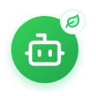
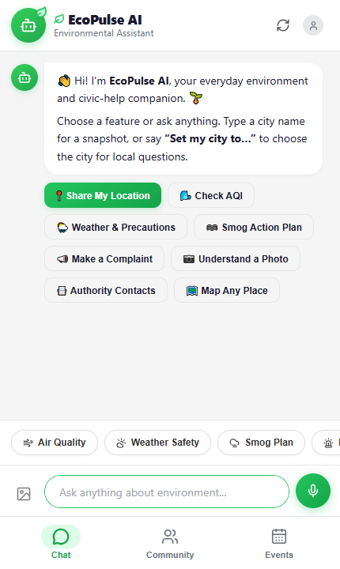
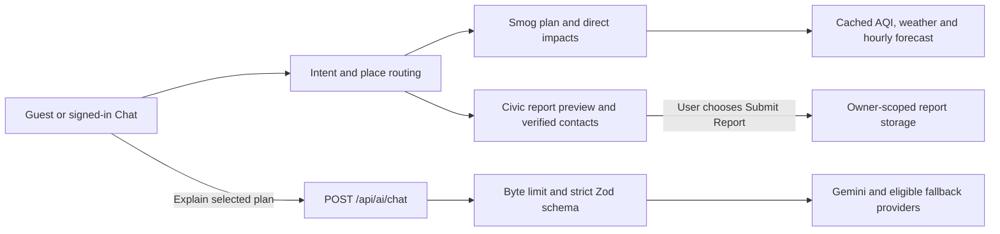

<div align="center">
  
  <h1>EcoPulse AI</h1>
  <p>
    <strong>Your personal AI companion for cleaner air, safer routines and smarter everyday decisions during urban pollution.</strong>
  </p>

  <p>
    <a href="https://ecopulse-ai-ruby.vercel.app">
      
    </a>
    
    
    
  </p>

  <p>
    
    
    
    
    
    
  </p>

  <p>
    <a href="https://ecopulse-ai-ruby.vercel.app">Live App</a>
    &nbsp;·&nbsp;
    <a href="https://youtu.be/mrQLC5kSaBU">Project Demo Video</a>
    &nbsp;·&nbsp;
    <a href="#interface-preview">UI Preview</a>
    &nbsp;·&nbsp;
    <a href="#-key-capabilities">Capabilities</a>
    &nbsp;·&nbsp;
    <a href="#-architecture">Architecture</a>
    &nbsp;·&nbsp;
    <a href="#-quick-start">Quick Start</a>
    &nbsp;·&nbsp;
    <a href="#verification">Verification</a>
    &nbsp;·&nbsp;
    <a href="#-privacy--safety-model">Privacy & Safety</a>
    &nbsp;·&nbsp;
    <a href="FIREBASE_SETUP.md">Firebase Setup</a>
  </p>
</div>

---

## Overview

**EcoPulse AI** helps families, schools and neighbourhoods plan around winter smog. Choose **Smog Action Plan**, enter a city and share a commute or household routine. The plan uses the latest available air-quality reading to suggest lower-emission travel, indoor-air improvements and community actions. Each action explains its impact. Choose **Explain these choices with AI** for a Gemini explanation grounded in that plan.

The Chat router uses environmental APIs for current readings, verified directories for municipal contacts and a server-side proxy for generative answers and web search. AI and search provider credentials stay on the server.

---

## Interface Preview

<div align="center">
  
  <p>EcoPulse Chat home screen</p>
</div>

---

## ✨ Key Capabilities

| Area | What It Does | Powered By |
| :--- | :--- | :--- |
| **Conversational Assistant** | Natural-language chat in **English, Hindi, and Hinglish** with automatic language detection, daily-life civic guidance, and deterministic fallback responses. | Gemini AI, OpenRouter Free, `fallbackBrain.js` |
| **Personalized Smog Action Plan** | Uses the confirmed city, household routine and upcoming daytime forecast. Families and schools can select **Explain these choices with AI** to ask how the recommended steps affect exposure and emissions. | `smogPlan.js`, Open-Meteo, server-side AI proxy |
| **Air Quality & Weather** | Shows current modeled U.S. AQI, pollutant estimates, and weather. The smog plan displays the AQI source time and does not use stale or undated readings as current. | Open-Meteo Air Quality & Forecast APIs |
| **Typo-Tolerant Global Maps** | Resolves misspelled or landmark-level locations (e.g., reserves, beaches, neighborhoods) into verified coordinates and Google Maps deep links. | Open-Meteo, Photon, Nominatim (OSM) |
| **Civic Grievance & Email Routing** | Identifies the incident jurisdiction, links official contacts where available, and prepares an editable draft. Opening Gmail requires confirmation and never sends the draft. | `authorityDirectory.js`, `agentTools.js` |
| **Grounded Web Research** | Answers current-events and policy questions with clickable sources and asks for a city when a local search needs one. | Tavily Search API (`/api/ai/chat`) |
| **Vision & Opt-In OCR** | Analyzes uploaded incident photos for severity and category, with private on-device classification and opt-in multilingual OCR (**English, Hindi, Marathi**). | Gemini Vision, Transformers.js (CLIP), Tesseract.js |
| **Community & Eco-Meetups** | Public location-tagged channel with newest messages at the bottom, stable per-user identity colours, eco-events with live seat counts, private event registrations, and guest reading in the public channel. | Firebase Auth, Cloud Firestore |

---

## 🌫 Challenge 6 — Urban Air Quality Assistant

EcoPulse directly addresses the challenge with:

- **Severe winter-smog advice** uses the source time, current AQI category and wind. The AQI card also shows available pollutant estimates.
- **Lifestyle personalization** for commute mode, work/school/outdoor routine, cooking fuel, air filtration, children, older adults, and heart/lung sensitivity.
- **Low-emission alternatives** such as public transit, carpooling, trip batching, anti-idling, and zero-tailpipe active travel when exposure conditions allow.
- **Indoor-air hacks** covering a cleaner-air room, HEPA use, damp cleaning, ventilation timing, cooking exhaust, and avoidance of ozone/ionizer devices.
- **24-hour AQI planning** finds the lowest modeled daytime value and warns when that period still poses a risk for a school or a sensitive household.
- **Direct impact** under each action explains what the choice changes. An optional GenAI follow-up uses the selected plan's advice and impacts, including when the user returns to an earlier plan.
- **Community action** covers school assemblies and pickup queues, neighbourhood shared trips, garden waste collection, and civic reporting.
- **Private lifestyle details** are used to tailor the plan, not stored in shared community documents.

---

## 🏗 Architecture

A Chat turn follows the same path in the Vite development server and the Vercel deployment.



| Responsibility | Implementation |
| --- | --- |
| Select an intent and city | `intentEngine.js` classifies the request. `placeNames.js` extracts the city and `placeTurn.js` handles confirmation. A lookup in another city leaves the household's chosen location intact. |
| Build a plan | `smogProfile.js` interprets stated conditions. `smogForecast.js` checks reading age and forecast hours. `smogAdvice.js` selects commute, indoor, cooking and community advice. `smogPlan.js` pairs each choice with its impact. |
| Explain a choice | `server/chatRequest.js` caps the HTTP body and checks photo headers. `server/chatSchema.ts` validates the request and normalizes it into typed messages. `server/aiCore.js` gives eligible providers time within one shared deadline. |
| Edit a report | The report card lets its owner correct the title, description, category and location before saving. Changing the location clears the old coordinates. `reportRecords.js` handles private cloud and device records. |
| Recover from failures | `AppErrorBoundary.jsx` offers reload and return-to-Chat controls after a rendering failure. `diagnostics.js` records fixed operation names and optional numeric status codes. |

### Provider Routing & Resilience

| Capability | Primary Provider | Fallback Chain |
| :--- | :--- | :--- |
| **Chat** | Google Gemini | Configured compatible provider, LLM7 or Pollinations → recorded plan impacts or a local reply |
| **Civic complaint drafts** | User-provided details and verified directory, formatted locally | An unaddressed draft when no local email is verified |
| **Grounded Web Search** | Tavily Basic Search | Gemini grounding |
| **Image Classification** | Gemini Vision | On-device CLIP (`onDeviceVision.js`) → User confirmation |
| **Document / Sign OCR** | Tesseract.js (opt-in) | Prompt user to clarify unclear text |
| **AQI and weather** | Configured WAQI/OpenWeather or Open-Meteo | Timestamped modeled data where available, otherwise an unavailable state |
| **Geocoding** | Open-Meteo | Photon or Nominatim for supported place lookups |

---

## 📁 Project Structure

<details>
<summary><strong>Click to expand repository layout</strong></summary>

```text
ecopulse-ai/
├── api/
│   └── ai/
│       ├── chat.js                  # Vercel serverless AI & Tavily proxy
│       └── health.js                # Provider health check endpoint
├── public/
│   └── bot-logo.svg                 # EcoPulse logo and browser tab icon
├── src/
│   ├── agent/
│   │   ├── agentOrchestrator.js     # Dispatches Chat turns to the matching handler
│   │   ├── smogPlan.js              # Household, school and neighbourhood advice
│   │   ├── environmentReplies.js    # AQI, weather and selected-plan explanations
│   │   ├── photoReports.js          # On-demand photo report workflow
│   │   ├── fallbackBrain.js         # Deterministic offline/error fallback responses
│   │   └── intentEngine.js          # Priority-ordered English/Hindi/Hinglish intent classifier
│   ├── components/
│   │   ├── BottomNav.jsx            # Mobile-first bottom navigation
│   │   ├── chat/
│   │   │   ├── ChatInput.jsx        # Auto-focused chat composer + image attachment
│   │   │   ├── Header.jsx           # App header, location badge & account menu
│   │   │   ├── InlineCards.jsx      # AQI, Report, Email (with CC & Gmail), Meetup & Map cards
│   │   │   ├── MessageBubble.jsx    # Markdown, citations & inline card renderer
│   │   │   └── QuickActions.jsx     # Context-aware city quick prompts
│   │   └── meetups/
│   │       └── EventCard.jsx        # Eco-event card with RSVP state
│   ├── contexts/
│   │   ├── AppContext.js            # Shared app context and hook
│   │   ├── AppProvider.jsx          # Selected city & private Chat session state
│   │   ├── AuthContext.jsx          # Shared authentication hook
│   │   └── AuthProvider.jsx         # Google, email-link and Guest sessions
│   ├── firebase/
│   │   ├── collections.js           # Firestore collection helpers
│   │   └── config.js                # Firebase initialization
│   ├── pages/
│   │   ├── LandingPage.jsx          # Entry & onboarding view
│   │   ├── ChatPage.jsx             # Main conversational assistant interface
│   │   ├── CommunityPage.jsx        # Public location-tagged community feed
│   │   ├── MeetupsPage.jsx          # Event discovery, creation & RSVP
│   │   └── ReportDetailPage.jsx     # Individual environmental report view
│   ├── services/
│   │   ├── agentTools.js            # Tool entry points used by Chat and civic flows
│   │   ├── aiClient.js              # Client wrapper for /api/ai/chat
│   │   ├── authorityDirectory.js    # Official municipal & forest authority lookup
│   │   ├── environmentalData.js     # AQI display helpers and environmental API exports
│   │   ├── reportRecords.js         # Owner-scoped cloud and device reports
│   │   ├── geminiService.js         # Browser-side chat, JSON and photo requests
│   │   ├── imageOcr.js              # Opt-in Tesseract.js OCR (EN/HI/MR)
│   │   └── onDeviceVision.js        # Private on-device CLIP image classifier
│   ├── App.jsx
│   ├── index.css
│   └── main.jsx
├── FIREBASE_SETUP.md                # Step-by-step Firebase & Firestore rules guide
├── firestore.rules                  # Strict Firestore security rules
├── firestore.indexes.json           # Composite query indexes
├── vercel.json                      # Vercel SPA + /api routing
└── vite.config.js                   # Vite config + local /api/ai dev proxy
```

</details>

---

## 🚀 Quick Start

### Prerequisites
- **Node.js 24 LTS (24.12 or later in the 24.x series)** and **npm**
- A **Google Gemini API key** ([Google AI Studio](https://aistudio.google.com/apikey)) is optional for model-powered replies. The smog plan and automated tests do not require one.
- A **Firebase project** (optional for local UI testing; required for cloud auth & Firestore community)

### Installation

```bash
# 1. Clone the repository
git clone https://github.com/surajns0033-collab/ecopulse-ai.git
cd ecopulse-ai

# 2. Install dependencies
npm ci

# 3. Create your local environment file
cp .env.example .env       # macOS / Linux
# copy .env.example .env   # Windows CMD / PowerShell

# 4. Start the local dev server (with built-in /api/ai proxy)
npm run dev
```

To verify the exact code shown on GitHub, check out that revision after cloning, or use **Code → Download ZIP** from that revision.

### Environment Variables

Configure these in `.env` (never commit `.env` to version control):

```env
# Server-side AI & Search (kept off the client bundle)
GEMINI_API_KEY=your_gemini_api_key
TAVILY_API_KEY=your_tavily_api_key          # Optional: grounded web search
OPENROUTER_API_KEY=your_openrouter_key      # Optional: free-tier fallback
OPENROUTER_MODEL=openrouter/free

# Firebase (client-side public config)
VITE_FIREBASE_API_KEY=
VITE_FIREBASE_AUTH_DOMAIN=
VITE_FIREBASE_PROJECT_ID=
VITE_FIREBASE_STORAGE_BUCKET=
VITE_FIREBASE_MESSAGING_SENDER_ID=
VITE_FIREBASE_APP_ID=
```

See [`.env.example`](.env.example) for all optional keys (including OpenWeatherMap, WAQI, and Google Maps).

---

## 🔐 Privacy & Safety Model

- **Minimal Public Footprint:** EcoPulse never copies user email addresses, phone numbers, Google display names, or precise GPS coordinates into public Firestore documents. Community posts store only the Firebase UID, chosen public alias, message text, timestamp, and an optional city/global label.
- **Chat location:** Chat verifies cities and asks you to confirm uncertain matches. Set a preferred city with “Set my city to …”, or explicitly share your device location to check rounded coordinates. Web search receives only the current query, not earlier conversation text.
- **Guest Mode:** Anonymous users can browse the public community channel in read-only mode without creating an account, enforced by [`firestore.rules`](firestore.rules).
- **Human-in-the-Loop Complaints:** Drafted complaint emails are **never** sent automatically. Users review, edit, copy, or open them in Gmail with explicit confirmation.
- **Jurisdiction Checks:** When an Indian city has no verified local contact, EcoPulse links to the official national portal for the issue, such as [CPGRAMS](https://pgportal.gov.in). It does not reuse Indian contacts for a photo or request from another country.
- **Distinguished Guidance:** Responses separate immediate on-the-spot emergency actions from formal grievance filing, and frame health tips as general information rather than medical diagnosis.

---

## ☁️ Deployment

### Firebase Setup
Follow [`FIREBASE_SETUP.md`](FIREBASE_SETUP.md) to enable **Google**, **Email/Password (Passwordless Email Link)**, and **Anonymous** sign-in providers, then deploy security rules and indexes:

```bash
npx firebase-tools deploy --only firestore:rules,firestore:indexes
```

### Vercel Deployment
The repository ships ready for Vercel with [`vercel.json`](vercel.json) and serverless endpoints (`api/ai/chat.js`, `api/ai/health.js`):
1. Add server-side keys (`GEMINI_API_KEY`, `TAVILY_API_KEY`, `OPENROUTER_API_KEY`) in **Vercel Project Settings → Environment Variables**.
2. Add `VITE_FIREBASE_*` variables for the client build.
3. Add your deployed Vercel domain under **Firebase Authentication → Settings → Authorized domains**.

---

## 🛠 Available Scripts

| Command | Description |
| :--- | :--- |
| `npm run dev` | Start Vite development server with the local `/api/ai` proxy |
| `npm run build` | Build optimized production bundle into `dist/` |
| `npm run preview` | Preview the production build locally |
| `npm run lint` | Run static checks with **Oxlint** |
| `npm test` | Run the Node regression suite with mocked external services |
| `npm run benchmark:submission` | Run and report the six submission criteria, including code complexity, coverage, security, startup budgets, accessibility and smog planning |
| `npm run benchmark` | Run 17 smog scenarios, route controls and a request-cache check with fixed inputs |
| `npm run test:coverage` | Measure Node test coverage |
| `npm run test:browser` | Check production bundle sizes and exercise Guest Chat, local photo fallback, plan explanations, private reports, events and keyboard access in Chrome after a device-only build |
| `npm audit --audit-level=moderate` | Check installed versions against published security advisories |
| `npm run test:rules` | Check authenticated access in local Firebase Auth and Firestore emulators (Java 21 required) |
| `npm run verify` | Run lint, Node tests and the production build |

---

## Verification

CI counts physical lines in every application, server, API, test and stylesheet module. A module of 150 lines fails the build. Strict TypeScript checks cover the chat request contract, and Zod validates untrusted input at runtime. Run `npm run quality:modules`, `npm run typecheck` and `npm run lint` for the code-quality checks. The full benchmark also runs Chrome, Firestore emulators and the production bundle checks.

After `npm ci`, run `npm run benchmark:submission` to reproduce the CI report with Node 24, Chrome and Java 21. The [verification guide](docs/quality-verification.md) lists each threshold, its scope and a recorded run.

- `npm test` covers city changes, stale AQI, severe-smog advice, Guest chat, photo request validation, and provider timeouts. It runs with mocked providers and requires no API keys.
- CI runs the production build, dependency audit, Chrome accessibility checks and Auth/Firestore emulator tests. It also measures JavaScript requested on Guest Chat entry and exercises photo inference with a small offline test model. To reproduce the Chrome suite, build with `VITE_FIREBASE_API_KEY=demo-key` and run `npm run test:browser`.

In Guest Chat, enter “Make a smog plan for our school in Delhi, India.” Select **Explain these choices with AI** to compare reducing exposure with reducing emissions. More prompts and reproducible checks are in the [verification guide](docs/quality-verification.md).

---

## 📄 License

This project is open-source under the **MIT License** — see the repository for details.

---

<div align="center">
  <p>Built for cleaner cities, faster civic action, and privacy-respecting communities.</p>
</div>
