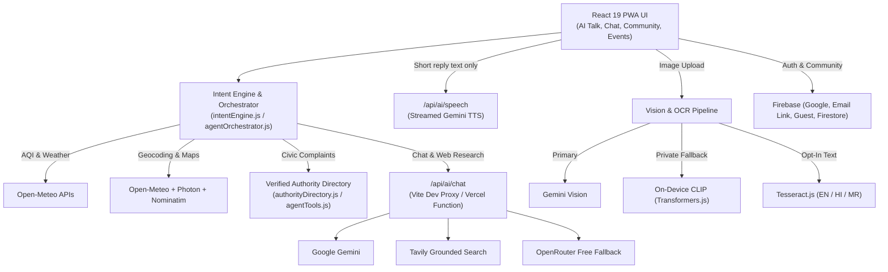

<div align="center">
  
  <h1>EcoPulse AI</h1>
  <p>
    <strong>Your personal AI companion for cleaner air, safer routines and smarter everyday decisions during urban pollution.</strong>
  </p>

  <p>
    <a href="https://ecopulse-ai-ruby.vercel.app">
      
    </a>
    
    
    
  </p>

  <p>
    
    
    
    
    
    
  </p>

  <p>
    <a href="https://ecopulse-ai-ruby.vercel.app">Live App</a>
    &nbsp;·&nbsp;
    <a href="#-key-capabilities">Capabilities</a>
    &nbsp;·&nbsp;
    <a href="#-architecture">Architecture</a>
    &nbsp;·&nbsp;
    <a href="#-quick-start">Quick Start</a>
    &nbsp;·&nbsp;
    <a href="#-privacy--safety-model">Privacy & Safety</a>
    &nbsp;·&nbsp;
    <a href="FIREBASE_SETUP.md">Firebase Setup</a>
  </p>
</div>

---

## Overview

**EcoPulse AI** is a mobile-first Progressive Web App and civic-environmental assistant built with React, Vite, Firebase, and a multi-provider AI proxy. It combines natural-language reasoning with real-time environmental telemetry, verified municipal/forest authority routing, on-device vision & OCR fallbacks, and a privacy-minimized community channel.

Instead of leaving users with generic chatbot replies or unverified contact details, EcoPulse AI routes queries through an intent engine to live APIs, verified official `.gov.in` / municipal directories, and server-side grounded search—while keeping all API secrets off the client bundle.

---

## ✨ Key Capabilities

| Area | What It Does | Powered By |
| :--- | :--- | :--- |
| **Conversational Assistant** | Natural-language chat in **English, Hindi, and Hinglish** with automatic language detection, daily-life civic guidance, and deterministic fallback responses. | Gemini AI, OpenRouter Free, `fallbackBrain.js` |
| **Live AQI & Weather** | Real-time Air Quality Index (`PM2.5`, `PM10`, `NO₂`, `O₃`), weather conditions, and actionable health insights for any city worldwide. | Open-Meteo Air Quality & Forecast APIs |
| **Personal Smog Action Plan** | Tailors a live-AQI plan to the city and the user's routine, with lower-emission choices and indoor-air steps. Chat adds a detailed breakdown and an AQI forecast window when available; AI Talk speaks the key actions. | Open-Meteo + deterministic exposure/action engine |
| **AI Talk** | Short spoken replies in the user's language, a sound-responsive dotted waveform, and a typed input without a visible transcript. Recent conversation text lets Talk pick up where you left off in the same tab. | Browser speech recognition, Gemini Flash-Lite TTS, browser voice fallback |
| **Typo-Tolerant Global Maps** | Resolves misspelled or landmark-level locations (e.g., reserves, beaches, neighborhoods) into verified coordinates and Google Maps deep links. | Open-Meteo, Photon, Nominatim (OSM) |
| **Civic Grievance & Email Routing** | Identifies the incident jurisdiction, links official contacts where available, and prepares an editable draft. Opening Gmail requires confirmation and never sends the draft. | `authorityDirectory.js`, `agentTools.js` |
| **Grounded Web Research** | Answers current-events and policy questions with clickable sources. AI Talk asks for clarification on local searches and does not substitute an uncited answer if search fails. | Tavily Search API (`/api/ai/chat`) |
| **Vision & Opt-In OCR** | Analyzes uploaded incident photos for severity and category, with private on-device classification and opt-in multilingual OCR (**English, Hindi, Marathi**). | Gemini Vision, Transformers.js (CLIP), Tesseract.js |
| **Community & Eco-Meetups** | Public location-tagged channel with newest messages at the bottom, stable per-user identity colours, local eco-events, RSVP support, and guest read-only mode. | Firebase Auth, Cloud Firestore |

---

## 🌫 Challenge 6 — Urban Air Quality Assistant

EcoPulse directly addresses the challenge with:

- **Severe winter-smog mode** driven by live AQI, PM2.5, PM10, temperature, and wind.
- **Lifestyle personalization** for commute mode, work/school/outdoor routine, cooking fuel, air filtration, children, older adults, and heart/lung sensitivity.
- **Low-emission alternatives** such as public transit, carpooling, trip batching, anti-idling, and zero-tailpipe active travel when exposure conditions allow.
- **Indoor-air hacks** covering a cleaner-air room, HEPA use, damp cleaning, ventilation timing, cooking exhaust, and avoidance of ozone/ionizer devices.
- **24-hour AQI planning** that identifies the forecast's lowest-AQI outdoor window.
- **Action → direct impact** cards that explain both exposure and emissions outcomes without inventing quantified savings.
- **Community-scale action** for no-burning, no-idling, hotspot evidence, and verified civic reporting.
- **Private lifestyle details** are used to tailor the plan, not stored in shared community documents.

---

## 🏗 Architecture

AI and web-search provider keys are configured server-side. Vite serves `/api/ai/chat` and `/api/ai/speech` locally; Vercel Functions serve them in production.



### Provider Routing & Resilience

| Capability | Primary Provider | Fallback Chain |
| :--- | :--- | :--- |
| **Chat** | Google Gemini | OpenRouter Free → Deterministic `fallbackBrain.js` |
| **Civic complaint drafts** | User-provided details and verified directory, formatted locally | An unaddressed draft when no local email is verified |
| **AI Talk** | Gemini Flash-Lite for conversation; Gemini Flash-Lite TTS for speech | Labeled browser voice when speech synthesis is unavailable |
| **Grounded Web Search** | Tavily Basic Search | Gemini grounding in Chat only; Talk says when it can't verify |
| **Image Classification** | Gemini Vision | On-device CLIP (`onDeviceVision.js`) → User confirmation |
| **Document / Sign OCR** | Tesseract.js (opt-in) | Prompt user to clarify unclear text |
| **AQI, Weather & Geo** | Open-Meteo | Photon / Nominatim (OSM) → Clear unavailable state |

---

## 📁 Project Structure

<details>
<summary><strong>Click to expand repository layout</strong></summary>

```text
ecopulse-ai/
├── api/
│   └── ai/
│       ├── chat.js                  # Vercel serverless AI & Tavily proxy
│       ├── health.js                # Provider health check endpoint
│       └── speech.js                # Streaming speech from short replies
├── public/
│   └── favicon.svg                  # App icon & brand mark
├── src/
│   ├── agent/
│   │   ├── agentOrchestrator.js     # Central intent execution, city extraction & context injection
│   │   ├── fallbackBrain.js         # Deterministic offline/error fallback responses
│   │   └── intentEngine.js          # Priority-ordered English/Hindi/Hinglish intent classifier
│   ├── components/
│   │   ├── BottomNav.jsx            # Mobile-first bottom navigation
│   │   ├── chat/
│   │   │   ├── ChatInput.jsx        # Auto-focused chat composer + image attachment
│   │   │   ├── Header.jsx           # App header, location badge & account menu
│   │   │   ├── InlineCards.jsx      # AQI, Report, Email (with CC & Gmail), Meetup & Map cards
│   │   │   ├── MessageBubble.jsx    # Markdown, citations & inline card renderer
│   │   │   └── QuickActions.jsx     # Context-aware city quick prompts
│   │   └── meetups/
│   │       └── EventCard.jsx        # Eco-event card with RSVP state
│   ├── contexts/
│   │   ├── AppContext.js            # Shared app context and hook
│   │   ├── AppProvider.jsx          # Selected city & private Chat session state
│   │   └── AuthContext.jsx          # Firebase Google, Email-link & Anonymous auth
│   ├── firebase/
│   │   ├── collections.js           # Firestore collection helpers
│   │   └── config.js                # Firebase initialization
│   ├── pages/
│   │   ├── LandingPage.jsx          # Entry & onboarding view
│   │   ├── ChatPage.jsx             # Main conversational assistant interface
│   │   ├── TalkPage.jsx             # Voice and typed input without a transcript
│   │   ├── CommunityPage.jsx        # Public location-tagged community feed
│   │   ├── MeetupsPage.jsx          # Event discovery, creation & RSVP
│   │   └── ReportDetailPage.jsx     # Individual environmental report view
│   ├── services/
│   │   ├── agentTools.js            # Verified contacts, reports, drafts & meetups store
│   │   ├── aiClient.js              # Client wrapper for /api/ai/chat
│   │   ├── authorityDirectory.js    # Official municipal & forest authority lookup
│   │   ├── environmentalData.js     # Open-Meteo, Photon & Nominatim integrations
│   │   ├── geminiService.js         # Gemini model chain & system instructions
│   │   ├── imageOcr.js              # Opt-in Tesseract.js OCR (EN/HI/MR)
│   │   └── onDeviceVision.js        # Private on-device CLIP image classifier
│   ├── App.jsx
│   ├── index.css
│   └── main.jsx
├── FIREBASE_SETUP.md                # Step-by-step Firebase & Firestore rules guide
├── firestore.rules                  # Strict Firestore security rules
├── firestore.indexes.json           # Composite query indexes
├── vercel.json                      # Vercel SPA + /api routing
└── vite.config.js                   # Vite config + local /api/ai dev proxy
```

</details>

---

## 🚀 Quick Start

### Prerequisites
- **Node.js 20+** and **npm**
- A **Google Gemini API key** ([Google AI Studio](https://aistudio.google.com/apikey))
- A **Firebase project** (optional for local UI testing; required for cloud auth & Firestore community)

### Installation

```bash
# 1. Clone the repository
git clone https://github.com/surajns0033-collab/ecopulse-ai.git
cd ecopulse-ai

# 2. Install dependencies
npm install

# 3. Create your local environment file
cp .env.example .env       # macOS / Linux
# copy .env.example .env   # Windows CMD / PowerShell

# 4. Start the local dev server (with built-in /api/ai proxy)
npm run dev
```

### Environment Variables

Configure these in `.env` (never commit `.env` to version control):

```env
# Server-side AI & Search (kept off the client bundle)
GEMINI_API_KEY=your_gemini_api_key
TAVILY_API_KEY=your_tavily_api_key          # Optional: grounded web search
OPENROUTER_API_KEY=your_openrouter_key      # Optional: free-tier fallback
OPENROUTER_MODEL=openrouter/free

# Firebase (client-side public config)
VITE_FIREBASE_API_KEY=
VITE_FIREBASE_AUTH_DOMAIN=
VITE_FIREBASE_PROJECT_ID=
VITE_FIREBASE_STORAGE_BUCKET=
VITE_FIREBASE_MESSAGING_SENDER_ID=
VITE_FIREBASE_APP_ID=
```

See [`.env.example`](.env.example) for all optional keys (including OpenWeatherMap, WAQI, and Google Maps).

---

## 🔐 Privacy & Safety Model

- **Minimal Public Footprint:** EcoPulse never copies user email addresses, phone numbers, Google display names, or precise GPS coordinates into public Firestore documents. Community posts store only the Firebase UID, chosen public alias, message text, timestamp, and an optional city/global label.
- **AI Talk:** EcoPulse does not save or upload microphone recordings. Speech recognition uses the browser's speech service, which can depend on the browser locale. Replies use the language of the current words, not the device locale. When you start by voice, the mic can listen for “stop speaking” during playback and briefly opens for an answer after a clarification. A final reply closes the mic. Tap **Stop** to end the turn, or tap the wave during playback to interrupt and answer without clearing the conversation. Talk keeps up to 12 recent text messages and any active clarification in this browser tab's session storage, separate from Chat and Community. Use **Clear talk conversation** or sign out to remove it. Recent text is used for AI follow-ups, but never sent to web search or speech synthesis; synthesis receives only the short reply and does not store generated audio. An explicit request like “Use my location” can use browser permission and rounded coordinates to verify a city. If Talk falls back to the browser's voice, it labels that playback.
- **Talk city follow-ups:** Say or type the city when Talk asks. If the mic doesn't return usable words, Talk keeps the original question open and offers a retry without repeating it aloud. A verified city chosen for local lookups is reused in the same tab. If the city was only discussed earlier, Talk asks before treating it as local. You can set your local city by saying or typing “My city is …”.
- **Guest Mode:** Anonymous users can browse the public community channel in read-only mode without creating an account, enforced by [`firestore.rules`](firestore.rules).
- **Human-in-the-Loop Complaints:** Drafted complaint emails are **never** sent automatically. Users review, edit, copy, or open them in Gmail with explicit confirmation.
- **Jurisdiction Checks:** When an Indian city has no verified local contact, EcoPulse links to the official national portal for the issue, such as [CPGRAMS](https://pgportal.gov.in). It does not reuse Indian contacts for a photo or request from another country.
- **Distinguished Guidance:** Responses separate immediate on-the-spot emergency actions from formal grievance filing, and frame health tips as general information rather than medical diagnosis.

---

## ☁️ Deployment

### Firebase Setup
Follow [`FIREBASE_SETUP.md`](FIREBASE_SETUP.md) to enable **Google**, **Email/Password (Passwordless Email Link)**, and **Anonymous** sign-in providers, then deploy security rules and indexes:

```bash
npx firebase-tools deploy --only firestore:rules,firestore:indexes
```

### Vercel Deployment
The repository ships ready for Vercel with [`vercel.json`](vercel.json) and serverless endpoints (`api/ai/chat.js`, `api/ai/health.js`, `api/ai/speech.js`):
1. Add server-side keys (`GEMINI_API_KEY`, `TAVILY_API_KEY`, `OPENROUTER_API_KEY`) in **Vercel Project Settings → Environment Variables**.
2. Add `VITE_FIREBASE_*` variables for the client build.
3. Add your deployed Vercel domain under **Firebase Authentication → Settings → Authorized domains**.

---

## 🛠 Available Scripts

| Command | Description |
| :--- | :--- |
| `npm run dev` | Start Vite development server with the local `/api/ai` proxy |
| `npm run build` | Build optimized production bundle into `dist/` |
| `npm run preview` | Preview the production build locally |
| `npm run lint` | Run static checks with **Oxlint** |
| `npm test` | Run location, voice-reply and speech-endpoint regression tests |

---

<div align="center">
  <p>Built for cleaner cities, faster civic action, and privacy-respecting communities.</p>
</div>
